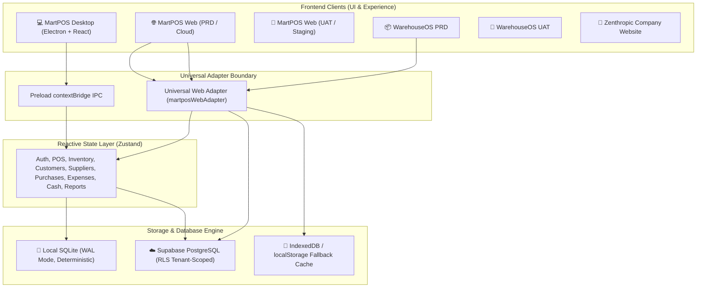

# 🗺️ Zenthropic Technologies — Enterprise Codebase Map

> **Generated Automatically:** 11/16/2026 | **Monorepo Version:** 2.0.0-enterprise

---

## 1. System Topology & Architecture Overview



---

## 2. Monorepo Application Matrix

| Package / Application | Directory | Role & Target | Storage Engine |
|---|---|---|---|
| **MartPOS Desktop** | `src/` | High-speed offline retail POS counter (barcode scanning, thermal printers, cash drawer) | `better-sqlite3` + Drizzle ORM |
| **MartPOS Web** | `packages/web/` | Browser-based cloud management, multi-device dashboard & cashier terminal | Supabase PostgreSQL + Local Storage |
| **WarehouseOS Web** | `packages/warehouse-web/` | Supply chain, batch bin tracking, purchase orders & logistics | Supabase PostgreSQL (Isolated Schema) |
| **Company Website** | `packages/company-site/` | Public SaaS marketing, pricing, dynamic software catalog & customer acquisition | Static / Vercel Edge CDN |
| **Shared Core Types** | `src/shared/` | Type contracts, MoneyMinor utilities, IPC channel definitions, formatters | Shared across all packages |

---

## 3. Active Feature Modules (16 Core Modules)

```
├── 🏷️ Catalog & Categories (categories, brands, units)
├── 📦 Products & Pricing (variants, cost/selling price, SKUs)
├── 📊 Barcodes (EAN-13, internal auto-generation, labels)
├── 🛒 Point of Sale (POS) (barcode lookup, cart, multi-tender, held bills)
├── 🧾 Returns & Exchanges (sales/purchases return, refund calculations)
├── 📈 Inventory & Stock (adjustments, batch lots, low-stock warnings)
├── 👥 Customers & Khata (credit limits, ledgers, recovery payments)
├── 🚚 Suppliers & Payables (vendor balances, supplier ledgers)
├── 📑 Purchases & GRN (purchase orders, item costing, receiving)
├── 💵 Cash Register & Shifts (opening drawer, cash-in/out, closing reports)
├── 💸 Store Expenses (operational expense categorization, receipts)
├── 📈 Reports & Business Intelligence (sales, profit/loss, inventory value)
├── 🔐 Users & Roles (cashier, manager, admin, permission matrices)
├── 🛡️ Audit Logs (system action trail, login events, security logs)
├── ⚙️ Settings (store details, receipt formatting, theme preferences)
└── 🔑 Licensing (3-day trial engine, machine code, enterprise activations)
```

---

## 4. Database Schema Map

| Table / Entity | Desktop SQLite Schema | Cloud Supabase Table | Key Purpose |
|---|---|---|---|
| **Organizations** | In-app store metadata | `public.organizations` | Multi-tenant tenant identifier (`org_id`) |
| **Subscriptions** | `licensing_state` | `public.subscriptions` | 3-day trial & SaaS tier license records |
| **Counters** | Counter hardware fingerprint | `public.counters` | Multi-counter terminal mesh synchronization |
| **Products** | `products`, `product_variants` | `public.cloud_products` | Synced catalog with barcode mappings |
| **Sales Invoices** | `sales`, `sale_items`, `sale_payments` | `public.cloud_sales` | Financial transaction records (minor units) |
| **Stock Movements** | `stock_movements` | `public.cloud_stock_movements` | Immutable inventory audit trail |
| **Customers** | `customers`, `customer_transactions` | `public.cloud_customers` | Customer Khata & credit balances |
| **Suppliers** | `suppliers`, `supplier_transactions` | `public.cloud_suppliers` | Vendor accounts & payables |
| **Expenses** | `expenses`, `expense_categories` | `public.cloud_expenses` | Store daily operational costs |
| **Cash Sessions** | `cash_sessions`, `cash_movements` | `public.cloud_cash_sessions` | Daily drawer shifts & cash reconciliations |

---

## 5. Security & Isolation Invariants

1. **Deterministic Money Calculation**: Integer minor units (`MoneyMinor` - paisa) across all layers. Zero floating-point drift.
2. **Multi-Tenant RLS Barrier**: Every Supabase query enforces `org_id` matching both database RLS and application-layer fail-closed filters.
3. **Hardware & Token Security**: Electron preload exposes only strict `window.martpos` API. Direct filesystem or database access from renderer is blocked.
4. **Air-Gapped Offline Capability**: Core desktop and web POS operate independently of network connectivity.
