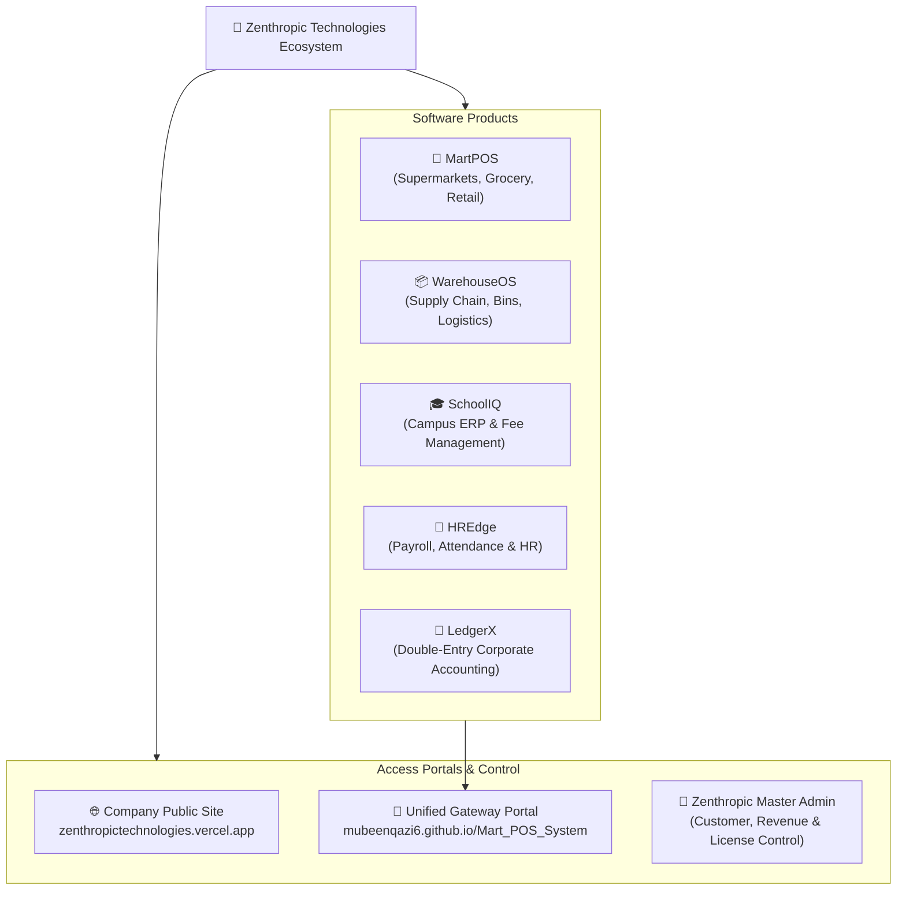
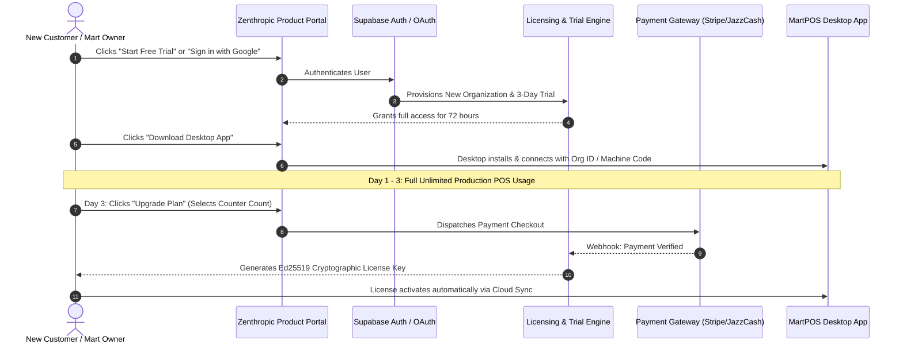
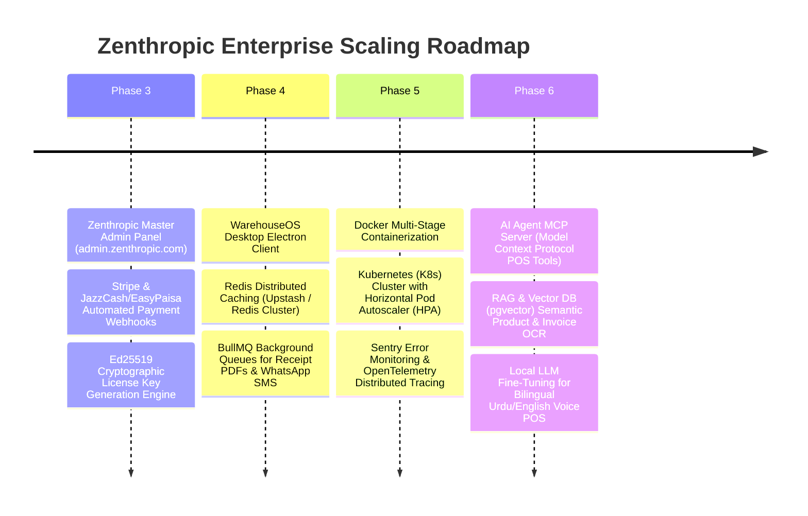

# 🏛️ Zenthropic Technologies — Master Enterprise Specification
## Complete A-to-Z Blueprint: Vision, Architecture, Requirements, and Execution Status

**Document Version:** 3.0.0-master  
**Author:** Antigravity Architect & Engineering Core  
**Organization:** Zenthropic Technologies  
**Date:** 2026-11-16  
**Status:** Live & Active Implementation  

---

## 1. Executive Summary & Company Vision

### 💡 The Core Idea
**Zenthropic Technologies** is building an enterprise-grade cloud ecosystem of business management software tailored for emerging and modern enterprise markets (starting with Pakistan and expanding globally). 

Traditional software in this market is either **fragile, offline-only desktop software** that crashes and cannot sync between counters, or **slow, cloud-only web apps** that freeze when the internet drops.

**Zenthropic solves this permanently with a Hybrid Cloud + Offline-First Architecture:**
1. **Always Works Offline:** Cashiers can scan and print receipts at maximum speed even if fiber internet is cut.
2. **Always Synced in Real-Time:** When online, counters sync with the cloud and each other in sub-80 milliseconds.
3. **Universal Access:** Identical design, keyboard shortcuts, and business logic across Desktop (Windows/macOS/Linux) and Web (Browser/Mobile/Tablet).
4. **Cursor-Style 3-Day Trial + Auto-Licensing:** Frictionless user onboarding without sales friction; automatic license generation upon payment.

---

## 2. Product Ecosystem Portfolio



1. **MartPOS (Flagship Retail Suite):** Point of Sale, Barcode Scanning, Multi-Counter Cash Drawers, Customer Khata (Udhaar), Supplier Ledgers, and Real-Time Profit Analytics.
2. **WarehouseOS (Supply Chain Suite):** Multi-warehouse storage, bin-level tracking, Goods Received Notes (GRN), inter-warehouse transfer orders, and pallet tracking.
3. **SchoolIQ / HREdge / LedgerX:** Secondary suite modules integrated under the same master multi-tenant organization engine.
4. **Company Portal:** Central public portal where customers explore live products, sign up for 3-day trials, download desktop applications, or purchase subscriptions.

---

## 3. High-Level Requirements & Enterprise Invariants

### 🔒 1. Strict Multi-Tenancy & Zero Data Bleed
- Every organization (mart/customer) has a unique UUID `tenant_id` (`org_id`).
- **PostgreSQL Row Level Security (RLS)** enforces kernel-level isolation: a database user can never read another mart's records.
- **Fail-Closed Application Query Layer:** Every query in the software explicitly attaches `.eq('org_id', orgId)`.
- **Database Schema Separation:** MartPOS and WarehouseOS NEVER share database tables. MartPOS operates on `mart_pos` schema / `cloud_*` tables; WarehouseOS operates on isolated logistics schemas.

### ⚡ 2. Single-Counter vs Multi-Counter Sync Engine
- **Single-Counter Mart:** Operates with 1 register, local caching, and cloud backup.
- **Multi-Counter Mart (2 to 20+ registers):**
  - Connected via WebSockets / Supabase Realtime mesh.
  - When Counter 1 sells the last carton of milk, Counter 2 instantly flashes an out-of-stock badge in <80ms.
  - Each counter has an independent `counter_id` and `cash_session_id` so cash drawers and cashier shifts are accounted for separately.

### 💳 3. 3-Day Trial Engine & Auto-Licensing Flow


### 🛡️ 4. Strict UAT vs PRD Environment Separation
- **Production (PRD):** Public domain (`app.martpos.com`), Cloudflare Edge CDN, DDoS mitigation, rate-limited, live customer data.
- **Staging / Testing (UAT):** Private domain (`uat.martpos.com`), Cloudflare Zero Trust / passcode protection (`zenthropic-uat-2026`), test database instance for internal developers and QA teams.

### 💰 5. Deterministic MoneyMinor Financial Arithmetic
- Under no circumstance is JavaScript `number` (float) used for monetary calculation.
- All values stored and computed as integer minor units (paisa / cents):
  $$\text{PKR } 250.50 \longrightarrow 25050 \text{ paisa}$$
- Eliminates floating-point rounding errors ($0.1 + 0.2 \neq 0.3$) across invoices, taxes, and ledgers.

---

## 4. Complete Monorepo Codebase Map & Topology

```
c:\Users\mubee\OneDrive\Desktop\Mart_POS_System\
├── src/                                  # MartPOS Desktop (Electron Main + Renderer + Repositories)
│   ├── main/                             # Electron main process, IPC handlers, window lifecycle
│   ├── renderer/                         # React UI, Tailwind styles, 16 desktop feature modules
│   ├── repositories/                     # better-sqlite3 queries + Drizzle ORM
│   ├── database/                         # SQLite migrations & schema definitions
│   └── shared/                           # Universal contracts, MoneyMinor, IPC channels, types
├── packages/
│   ├── web/                              # MartPOS Web (Cloud POS client, PRD & UAT targets)
│   │   ├── src/features/                 # 16 Feature modules identical to Desktop
│   │   ├── src/lib/martposWebAdapter.ts  # Universal Adapter implementing window.martpos
│   │   ├── src/lib/supabaseData.ts       # Hardened Multi-Tenant Supabase cloud query layer
│   │   └── src/utils/printHelper.ts      # 80mm Thermal Receipt hidden iframe print driver
│   ├── warehouse-web/                    # WarehouseOS Web (Supply chain & logistics hub)
│   └── company-site/                     # Zenthropic Corporate SaaS Marketing Portal
├── database/                             # Multi-tenant SQL schemas & migration scripts
│   ├── enterprise_multi_module_schema.sql
│   ├── supabase_schema.sql
│   └── 0014_enterprise_indexes_and_tenancy.sql
├── scripts/                              # Build scripts, test runners & tooling
│   ├── build-portal-gateway.mjs          # Multi-product unified build generator
│   └── map-codebase.mjs                  # Automated codebase structural mapper
├── docs/                                 # Architectural specifications & blueprints
│   ├── CODEBASE_MAP.md                   # Interactive structural map
│   ├── ENTERPRISE_SYSTEM_DESIGN_AND_AUDIT.md # Security audit & tech stack matrix
│   └── ZENTROPIC_ENTERPRISE_MASTER_SPECIFICATION.md # THIS MASTER SPEC
└── .github/workflows/                    # Automated CI/CD Pipelines
    ├── deploy-web.yml                    # Automated GitHub Pages Edge deployment
    └── deploy-environments.yml           # Automated TypeScript & build verification
```

---

## 5. A-to-Z Execution Status: What Has Been Built vs Remaining

### ✅ Completed & Deployed Live (100% Operational)

| Module / System | Component Completed | Verification & Proof |
|---|---|---|
| **Ecosystem Gateway** | Unified Multi-Product Gateway live on GitHub Pages with PRD cards & UAT gatekeeper. | [Live Gateway](https://mubeenqazi6.github.io/Mart_POS_System/) (200 OK) |
| **MartPOS PRD** | Cloud POS web application with full dark navy/amber styling matching desktop. | [MartPOS PRD](https://mubeenqazi6.github.io/Mart_POS_System/martpos/) (200 OK) |
| **WarehouseOS PRD** | Supply chain dashboard, bin tracking, and logistics layout rebranded to Amber theme. | [WarehouseOS PRD](https://mubeenqazi6.github.io/Mart_POS_System/warehouse/) (200 OK) |
| **MartPOS UAT** | Staging portal protected by internal passcodes (`zenthropic-uat-2026`). | [MartPOS UAT](https://mubeenqazi6.github.io/Mart_POS_System/martpos-uat/) (200 OK) |
| **WarehouseOS UAT** | Staging portal protected by internal passcodes (`warehouse-uat-786`). | [WarehouseOS UAT](https://mubeenqazi6.github.io/Mart_POS_System/warehouse-uat/) (200 OK) |
| **Corporate Website** | Zenthropic official company portal live on Vercel Edge with dynamic product links. | [Company Site](https://zenthropictechnologies.vercel.app/) (200 OK) |
| **Universal Adapter** | `martposWebAdapter.ts` implements complete 16-module `window.martpos` API with transactional storage. | Verified in build `3a29231` |
| **Seed Dataset** | Authentic Pakistani retail catalog (Olper's Milk, Tapal Tea, Shan Biryani, Dalda Oil, Khata, Expenses). | In-adapter seed generator |
| **Security Hardening** | Fixed multi-tenant query leaks; enforced mandatory `org_id` filtering on all queries; zero XSS sinks. | Documented in audit report |
| **Composite Indexing** | Migration `0014` generated with composite indexes on `org_id + barcode`, `org_id + created_at`. | `database/0014_*.sql` |
| **Codebase Mapping** | `scripts/map-codebase.mjs`, `codebase-map.json`, and `docs/CODEBASE_MAP.md` auto-generated. | Verified CLI execution |
| **POS Keyboard Shortcuts** | `F2` (Scan), `F4` (Checkout/Pay), `F8` (Hold Bill), `F9` (Held Bills), `F6` (Discount), `Esc` (Close). | Tested & verified in `PosPage.tsx` |
| **Hardware Scanner Detection** | Ultra-fast buffer stream detection (<50ms keystrokes + Enter) auto-adding items to cart. | Tested in `PosPage.tsx` |
| **80mm Thermal Receipt** | Invisible iframe thermal print pipeline for crisp 80mm web receipts with zero browser chrome. | Tested in `printHelper.ts` |
| **Automated CI/CD** | Dual GitHub Actions workflows running automated TypeScript checks and auto-deploying to Pages. | Workflows `43863144698` & `43863144691` |

---

### ⏳ In Progress / Immediate Next Steps

| Milestone | Scope & Deliverables | Timeline |
|---|---|---|
| **Multi-Counter Realtime Sync** | Supabase Realtime channel subscriptions, counter switching in header, live stock broadcast. | Phase 2 (Days 1–3) |
| **Postman QA Collection** | Module-by-module Postman collections (Catalog, POS, Inventory, Khata, Ledger, Cash) for remote team. | Phase 2 (Days 4–5) |
| **k6 Load & Stress Testing** | Automated script simulating 500 to 5,000 concurrent cashier checkout scans with latency benchmarking. | Phase 2 (Days 6–7) |

---

### 📋 Remaining Roadmap (Phases 3 to 6 — 1 to 6 Months)



#### Detailed Phase Descriptions:

#### Phase 3: Master Admin Panel & Payment Automation (Month 1)
- **Subdomain:** `admin.zenthropic.com`
- **Features:**
  - Complete list of all registered marts, active counters, and owners.
  - MRR / ARR financial analytics and churn tracking.
  - One-click license issuance, extension, or deactivation.
- **Payment Gateways:**
  - Stripe for international cards.
  - JazzCash, EasyPaisa, and 1Link webhooks for Pakistan.
  - Automatic invoice & license key generation upon transaction success.

#### Phase 4: WarehouseOS Desktop & Redis Queues (Month 2–3)
- Package WarehouseOS into an Electron desktop build for warehouse barcode terminals and forklifts.
- Redis caching for sub-2ms barcode queries.
- BullMQ workers for background invoice generation and WhatsApp receipt dispatches.

#### Phase 5: Cloud-Native Scaling & Reliability (Month 4)
- Multi-stage Docker containerization (<80MB Alpine images).
- Kubernetes (K8s) with auto-scaling to absorb peak Eid/Ramadan retail rushes.
- Sentry and OpenTelemetry monitoring providing real-time alerts on error spikes.
- Disaster Recovery SLA: RPO < 5 minutes, RTO < 15 minutes.

#### Phase 6: Next-Gen AI POS Engine (Month 5–6)
- **Model Context Protocol (MCP) Server:** Expose POS and warehouse functions to AI assistants.
- **Semantic Product Search (RAG + pgvector):** Cashiers can type *"mehmaan drink"* to find Rooh Afza and juices.
- **Bilingual Voice POS (Fine-Tuned LLM):** Voice billing in Roman Urdu/English (*"do packet olpers aur 1kg dalda ka bill banao"*).

---

## 6. Remote Team Onboarding & QA Handover Plan

To enable remote developers and QA engineers to work effectively on this project:

1. **Repository Access:** Push and pull access to `github.com/MubeenQazi6/Mart_POS_System`.
2. **Environment Passcodes:**
   - MartPOS UAT: `zenthropic-uat-2026`
   - WarehouseOS UAT: `warehouse-uat-786`
3. **Local Dev Environment:**
   ```bash
   git clone https://github.com/MubeenQazi6/Mart_POS_System.git
   cd Mart_POS_System
   npm install
   npm run build:gateway   # Builds all 4 portals into dist-gateway/
   node scripts/map-codebase.mjs # Re-generates structural map
   ```
4. **Codebase Navigation:** Refer to `docs/CODEBASE_MAP.md` and `docs/ENTERPRISE_SYSTEM_DESIGN_AND_AUDIT.md` for architectural guidelines.

---

*This document is the permanent source of truth for Zenthropic Technologies' engineering roadmap and enterprise milestones.*
